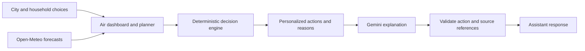

# SaafSky

### Know your air. Plan your day with confidence.

SaafSky is a personal air-quality companion that helps people turn changing city air conditions into practical decisions for their day. It brings forecasts, household-aware guidance, indoor-air actions, commute comparisons, and an AI assistant together in one connected experience.

[Open SaafSky](https://saafsky.vercel.app) · English and Hindi · Mobile and desktop

## The opportunity

**Chosen vertical:** Urban families and daily commuters making decisions around changing air quality.

Air quality affects everyday choices: when to go outside, how to travel, and what to do at home. SaafSky brings those decisions into one place for families, commuters, and people planning outdoor activities. A city forecast becomes a personalized plan that reflects household needs and the time available.

## One context, useful decisions

Choose a city and household preferences once. The dashboard, planner, indoor advisor, and assistant share the same location and forecast context, so recommendations remain consistent as users explore their options.

| For the user                   | What SaafSky brings together                                                                        |
| ------------------------------ | --------------------------------------------------------------------------------------------------- |
| **A clearer view of the day**  | City air quality, pollutants, hourly trends, and source times in one dashboard.                     |
| **Guidance that fits**         | Actions shaped by household sensitivity, children, routines, commuting, and indoor cooking context. |
| **A practical plan**           | Forecast-aware outing comparisons, indoor-air actions, and commute emissions estimates.             |
| **An answer in your language** | A contextual assistant in English and Hindi, connected to the same action plan.                     |

## A day with SaafSky

1. **Choose your city and household context.** Review the current modeled air quality and the actions selected for your circumstances.
2. **Plan an outing.** Set an available window, duration, and optional commitment to compare complete forecast periods.
3. **Explore choices at home and on the road.** Get indoor-air guidance and compare commute emissions using visible assumptions.
4. **Ask a follow-up.** The assistant explains the selected plan in English or Hindi and links to approved sources.

## How it works



The recommendation engine also supplies the rule-based plan when the AI service is unavailable. See [architecture](docs/architecture.md) for the full data flow.

## What you can do

| Feature                      | Experience                                                                                                                                                                                                 |
| ---------------------------- | ---------------------------------------------------------------------------------------------------------------------------------------------------------------------------------------------------------- |
| **Live air dashboard**       | Explore current modeled US AQI, PM2.5, PM10, an hourly forecast comparison, source attribution, and update times for a selected city. Move directly from the forecast to the outing planner.               |
| **Personal air plan**        | See prioritized, household-aware actions with clear reasons and evidence links. Preferences include sensitive household members, children, outdoor exercise, commuting, and cooking smoke.                 |
| **Outing planner**           | Compare complete forecast windows with your available time, activity duration, household context, and fixed commitments. Fill an editable window from the next consecutive forecast hours with one action. |
| **Indoor-air guide**         | Find practical actions for cooking smoke, filtration, dust, and outdoor-air conditions; estimate a smoke CADR for your room and compare a purifier's reported rating.                                      |
| **Commute impact**           | Compare estimated transport emissions across bus, rail, walking, cycling, and custom options using transparent factors and travel assumptions. Review current modeled city air alongside the comparison.   |
| **Ask SaafSky**              | Get a concise English or Hindi explanation of your current plan from Gemini, grounded in selected actions and approved sources. A rule-based plan is ready whenever AI is not selected or available.       |
| **Scenario explorer**        | Adjust illustrative air-quality and household inputs and compare two household plans side by side, with reasons and sources. The explorer makes no external service calls.                                 |
| **Preferences and language** | Save your city, set household context, switch between English and Hindi, and clear saved preferences.                                                                                                      |

## Product strengths

- **Practical decisions:** A deterministic recommendation engine selects actions before Gemini explains them.
- **Connected experience:** The dashboard, planner, indoor guidance, and assistant use consistent city and household context.
- **Evidence-aware AI:** Gemini receives a compact context; structured replies are validated, and action and source references are checked against the approved catalog.
- **Trustworthy data labels:** Forecasts identify the US AQI standard, model source, forecast time, and retrieval time.
- **Built for resilience:** Core air planning, recommendation, scenario, and indoor guidance remain available independently of Gemini.
- **Responsive and accessible:** Shared navigation, semantic controls, keyboard support, text labels alongside AQI colors, and generous touch targets work across mobile, tablet, and desktop layouts.
- **Bilingual by design:** English and Hindi are available across the product, with the chosen language carried into assistant requests.

## Engineering evidence

| Area                  | How SaafSky addresses it                                                                                     | Explore                                                                          |
| --------------------- | ------------------------------------------------------------------------------------------------------------ | -------------------------------------------------------------------------------- |
| **Code quality**      | Strict TypeScript, modular provider adapters, validated boundaries, and deterministic domain functions.      | [Architecture](docs/architecture.md) · [Quality](docs/quality.md)                |
| **Security**          | Server-side credentials, bounded requests, shared rate limits, origin checks, and validated AI references.   | [Security and privacy](docs/security-privacy.md) · [API](docs/api.md)            |
| **Efficiency**        | Cached air and city lookups, bounded provider requests, and an enforced client JavaScript budget.            | [Data sources](docs/data-sources.md) · [Testing](docs/testing.md)                |
| **Testing**           | Unit, production-browser, accessibility, public API protection, and live-provider checks.                    | [Testing](docs/testing.md) · [Measured results](docs/quality.md)                 |
| **Accessibility**     | Semantic controls, keyboard navigation, visible focus, bilingual content, and responsive touch targets.      | [Accessibility](docs/accessibility.md)                                           |
| **Problem alignment** | Household-aware air guidance connects forecasts, routines, indoor actions, and sustainable travel decisions. | [Decision policy](docs/decision-policy.md) · [Methodology](docs/data-sources.md) |

## Air data and methodology

Open-Meteo provides city lookup and air-quality forecasts, with atmospheric-model attribution to the Copernicus Atmosphere Monitoring Service (CAMS). SaafSky displays the **US AQI** standard and labels the data as a model forecast, with source and time context. PM2.5 and PM10 appear in µg/m³ when valid values are available.

Recommendation and planning rules are deterministic TypeScript. Gemini explains the selected actions; it does not set AQI values or replace the decision engine. The indoor advisor provides practical household guidance from selected context and outdoor conditions. The commute calculator shows its assumptions and factors so the comparison is easy to interpret. See [data sources](docs/data-sources.md) and [decision policy](docs/decision-policy.md) for methodology.

## Run locally

Use Node.js **26.x** to match the deployed runtime. Node.js 22.18 or newer is supported for local development.

```sh
npm ci
npm run dev
```

Open http://localhost:3000. Air-quality lookup, city search, planning, and the deterministic assistant plan work without Gemini credentials. To enable AI explanations locally, configure server-side variables in `.env.local`:

```dotenv
GEMINI_API_KEY=
GEMINI_MODEL=gemini-3.5-flash-lite
GEMINI_FALLBACK_MODEL=
UPSTASH_REDIS_REST_URL=
UPSTASH_REDIS_REST_TOKEN=
RATE_LIMIT_HASH_SECRET=
SAAFSKY_PUBLIC=false
```

Gemini requests use server-side credentials and shared Upstash rate limits. Production also uses Vercel's trusted visitor address and `SAAFSKY_PUBLIC=true`. Provider access in this deployment uses free tiers; availability, quotas, and eligibility follow each provider's current terms. See [security and privacy](docs/security-privacy.md) for configuration and data flow.

## Verify the product

On Windows, run the complete local release check from the repository root:

```powershell
.\scripts\verify.ps1 -Browser
```

This runs ESLint, strict typechecking, unit coverage, a production build, compressed client-JavaScript budget checks, production-browser journeys, responsive and accessibility checks, and public API protection checks. Mocked provider responses keep these checks repeatable and quota-free.

For a separate live-provider check after a production build, run:

```powershell
.\scripts\smoke-live.ps1 -RequireGemini
```

This verifies an AI-mode response using the key and Upstash credentials in `.env.local`. The script prints concise results without secret values or generated answer text.

Latest local verification on **November 26, 2026**:

- **101 unit tests passed.** The coverage run measured 99.80% lines, 96.93% branches, and 99.04% functions across modules loaded by the unit suite; configured minimums are 90%, 85%, and 90% respectively.
- **51 production-browser tests passed**, covering both languages, in-flight search and assistant-error language changes, focused assistant announcements, seven routes, keyboard-operated mobile navigation, household comparison, key journeys, and layouts from 320px through 1440px.
- **2 public API protection tests passed**, verifying public request validation and required protection behavior.
- **Production smoke on November 18** at [saafsky.vercel.app](https://saafsky.vercel.app): page, air API, city lookup, and Gemini chat in AI mode returned successfully for that deployment.
- **Client JavaScript: 260.7 KiB gzip** across 16 emitted assets, within the enforced 300 KiB project budget.

Coverage describes modules loaded by the unit suite; the browser, API protection, bundle, and live-provider checks add separate evidence for rendered behavior, request boundaries, resource size, and external integrations. Use `npm run check:bundle` to inspect the current production bundle.

## Privacy-forward design

SaafSky has no account or profile database. The selected city is stored in browser local storage, household preferences use session storage, and chat remains in page memory. Upstash stores shared rate-limit counters. The settings page updates or clears saved preferences; the assistant can clear its conversation. When Gemini is enabled, the server sends the question, recent conversation context, modeled air summary, and selected actions. Full details are in [security and privacy](docs/security-privacy.md).

The interface supports keyboard navigation, visible focus, semantic controls, source labels, text-based forecast summaries, and 48px primary touch targets. Automated axe checks and browser journeys exercise all product routes at mobile and desktop widths. See [accessibility](docs/accessibility.md) for the interaction coverage.

## Technical documentation

- [Architecture and data flow](docs/architecture.md)
- [Code quality practices](CODE_QUALITY.md)
- [Challenge requirement traceability](PROBLEM_ALIGNMENT.md)
- [API reference](docs/api.md)
- [Quality engineering and measured evidence](docs/quality.md)
- [Data sources and impact methodology](docs/data-sources.md)
- [Recommendation and planning policy](docs/decision-policy.md)
- [Security and privacy](docs/security-privacy.md)
- [Accessibility](docs/accessibility.md)
- [Testing and verification](docs/testing.md)
- [Security reporting](SECURITY.md)

SaafSky provides general air-quality decision support to help people plan their day. Follow existing clinician guidance for individual medical decisions.
