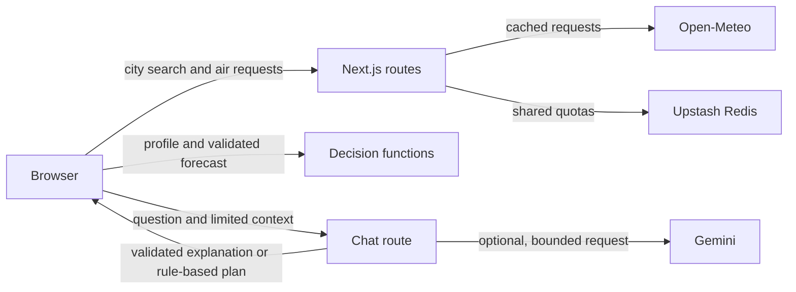

# Architecture

SaafSky is a bilingual Next.js application with responsive browser experiences and server-side route handlers. Open-Meteo supplies city search and air-quality forecasts; Gemini adds optional explanations. Deterministic TypeScript rules select recommendations and compare planning choices.

## Product flow

The browser stores the selected city in local storage and household choices in session storage. Chat history stays in page memory. A chat request carries the question, up to two previous exchanges, and limited air-quality context. The server creates the action list, then validates the model's action and evidence references. The browser resolves approved evidence IDs to source links before displaying an answer. For privacy, keep questions focused on air quality and daily routines, using generalized household context.

The shared application shell gives every route consistent desktop and mobile navigation. English and Hindi labels, guidance, and assistant language follow the selected preference. Seven product routes cover the dashboard, outing planner, indoor advisor, commute impact, assistant, scenario explorer, and settings.

## Architecture boundaries

- `src/features/air-quality` validates provider data; `src/server/air-provider.ts` caches air responses.
- `src/features/recommendations`, `planner`, `indoor`, and `sustainability` hold decision and calculation logic independently of presentation.
- `src/app/api` validates requests and coordinates providers; `src/server/chat.ts` owns the server-side Gemini adapter. Its injected text-client contract is tested independently, with model, request-size, and timeout limits read from validated server configuration.
- The chat planner passes one typed air context containing the validated AQI and bounded forecast into explanation logic; this keeps forecast state explicit across the API, decision engine, and Gemini request.
- `src/components` and `src/hooks` render the experience and manage browser preferences.

The dashboard, recommendation engine, planner, indoor guide, and scenario explorer are useful independently of Gemini. When current air data is not available, SaafSky presents its data state clearly and keeps general indoor guidance accessible. Air forecasts use a 30-minute cache; city results use a 24-hour cache. Production request budgets are shared through Upstash, with per-visitor protection on Vercel.

See [data sources](data-sources.md), [decision policy](decision-policy.md), and [security and privacy](security-privacy.md) for implementation details.
