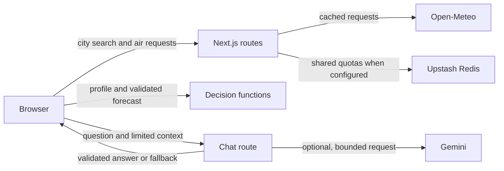

# Architecture

SaafSky is a Next.js application with browser interfaces and server-side route handlers. Environmental information comes from Open-Meteo; Gemini is an optional explanation service. The recommendation engine and calculations are deterministic TypeScript functions.

The browser keeps the chosen city in local storage and household choices in session storage. Chat history is held in page memory. Requests to the chat endpoint include a question, recent conversation and limited environmental context; the server constructs its own action list before checking AI action and evidence references. The browser resolves evidence IDs through the approved catalog before rendering source links. Do not enter personal or medical details in chat.

The root layout provides the same responsive, keyboard-accessible page navigation across the dashboard, planner, indoor advisor, impact calculator, assistant, settings and scenario explorer. Desktop users see the destinations in a shared navigation bar; mobile users open them from a native disclosure to preserve space for page content. Route pages own their task content while the shared shell keeps the main destinations one step away.

## Boundaries

- `src/features/air-quality` validates provider data; `src/server/air-provider.ts` caches air responses.
- `src/features/recommendations`, `planner`, `indoor`, and `sustainability` contain decision and calculation logic independent of presentation.
- `src/app/api` validates requests and handles provider failures. `src/server/chat.ts` is the server-side AI adapter.
- `src/components` and `src/hooks` present data and manage browser state.

The dashboard, recommendations and planner work without Gemini. An unavailable air provider is different: current outdoor guidance cannot be generated without usable air data. Caching is provided by the hosting environment and is not a guarantee that all server instances share a cache.

See [data sources](data-sources.md), [decision policy](decision-policy.md), and [security and privacy](security-privacy.md) for the limits at each boundary.
